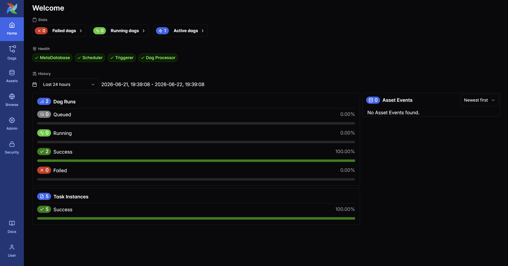
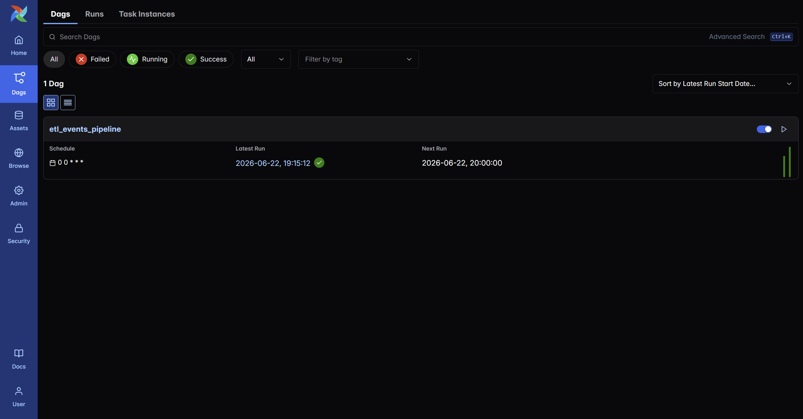
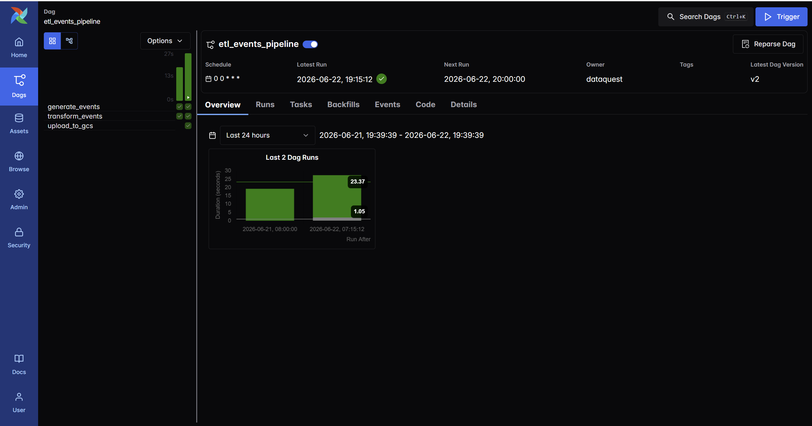
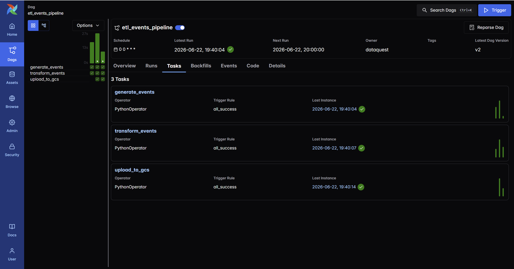
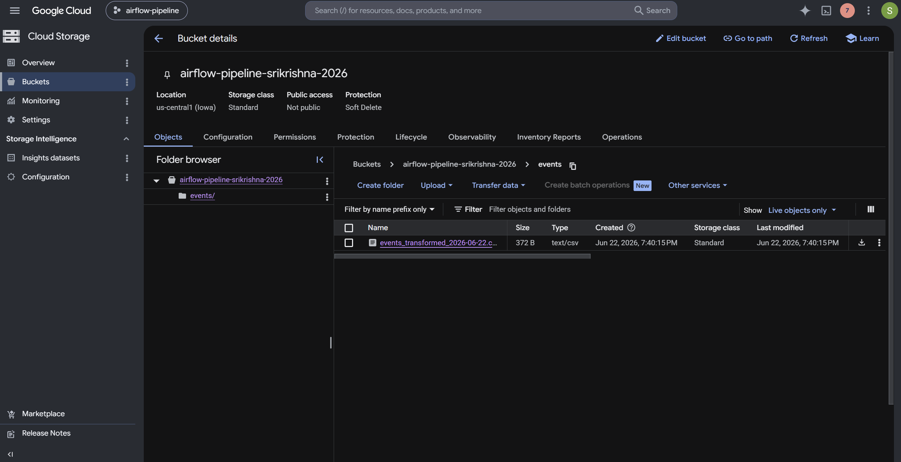
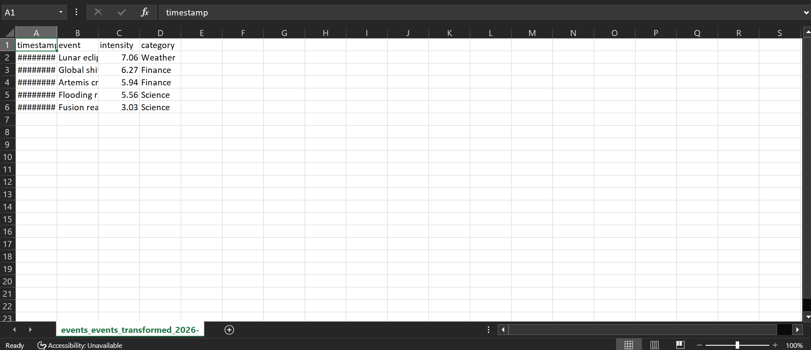
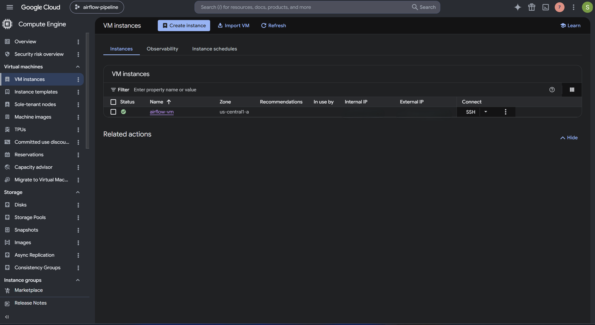
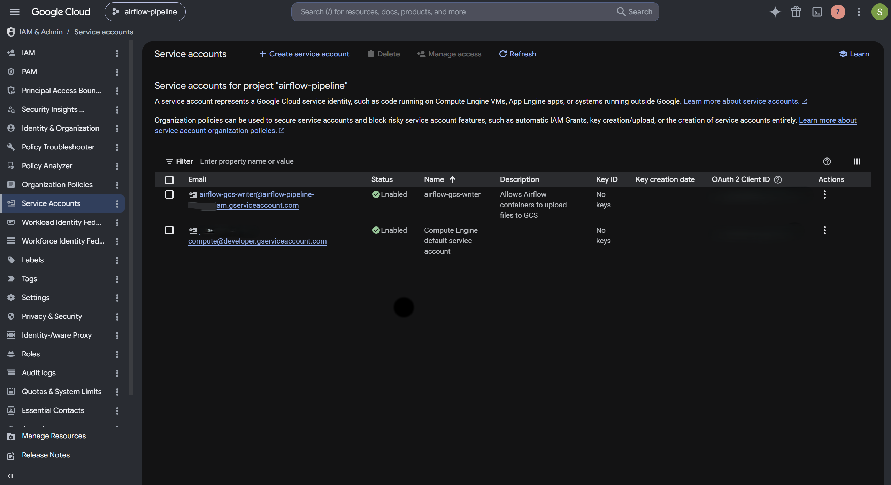

# ☁️ Airflow ETL Pipeline on Google Cloud Platform (Compute Engine VM)

A production-style Apache Airflow ETL pipeline deployed to **Google Cloud Platform** using a single Compute Engine VM running Docker Compose. The pipeline generates event data, transforms it, and uploads the result to Google Cloud Storage — automatically, on a schedule.

This project is the **GCP counterpart** to my [AWS ECS Fargate deployment](https://github.com/KRISHNA-05-06/airflow-aws-deployment) — the same pipeline, deployed two different ways across two clouds.

---

## 🏗️ Architecture

```
Local Project (airflow-gcp/)
      ↓  git clone
Compute Engine VM (Ubuntu 24.04 LTS, e2-medium)
      ↓  docker compose build + up
┌─────────────────────────────────────────────┐
│  api-server │ scheduler │ triggerer │ dag-processor │
│                  postgres                     │
└─────────────────────────────────────────────┘
      ↓                              ↓
Airflow UI (port 8080)         Google Cloud Storage
via VM external IP             (transformed CSV output)
      ↑
Service account (metadata-based auth — no key files)
```

Unlike the AWS deployment (ECS Fargate + ECR + RDS + ALB — a multi-service managed architecture), the GCP approach runs everything on **one VM with docker-compose**: PostgreSQL as a container, no managed database, no load balancer. Simpler infrastructure, same pipeline.

---

## 📦 ETL Pipeline

**DAG: `etl_events_pipeline`** — three tasks, scheduled daily.

| Task | Description |
|---|---|
| `generate_events` | Generates synthetic event data (timestamp, event, intensity, category) |
| `transform_events` | Sorts events by intensity score descending |
| `upload_to_gcs` | Uploads the transformed CSV to a Google Cloud Storage bucket |

**Flow:** `generate_events → transform_events → upload_to_gcs`

Each daily run writes a date-stamped file (e.g. `events/events_transformed_2026-06-22.csv`) to GCS, building a history of snapshots — a common production pattern.

---

## ☁️ GCP Resources

| Resource | Purpose |
|---|---|
| **Compute Engine VM** | Ubuntu 24.04 LTS, e2-medium (2 vCPU / 4 GB), runs all containers |
| **Google Cloud Storage** | Persistent destination for the pipeline's CSV output |
| **Service Account** | `airflow-gcs-writer` — grants the VM write access to GCS (metadata-based auth, no key files) |
| **Firewall Rule** | Allows inbound traffic on port 8080 (Airflow UI), restricted to a trusted IP |
| **VPC Network** | Default network hosting the VM and firewall rule |

---

## 🚀 Deployment Steps

### Prerequisites
- GCP account with billing enabled
- gcloud CLI installed locally
- Docker (installed on the VM during setup)

### Step 1: Create the VM
Compute Engine → Create Instance:
- Region `us-central1`, Zone `us-central1-a`
- Series E2, machine type `e2-medium`
- Boot disk: **Ubuntu 24.04 LTS** (standard, not Minimal), 30 GB Balanced persistent disk
- Security → "Control VM access through IAM permissions" **unchecked**
- Identity and API access → "Allow full access to all Cloud APIs"

### Step 2: Open port 8080
VPC Network → Firewall → Create rule `allow-airflow-8080`:
- Ingress, Allow, All instances in network
- TCP port `8080`, source restricted to your IP (`/32`)

### Step 3: Install Docker on the VM (via SSH)
```bash
sudo apt update && sudo apt upgrade -y
sudo apt install -y docker.io docker-compose-v2 nano
sudo systemctl start docker
sudo systemctl enable docker
sudo usermod -aG docker $USER
# reconnect SSH for the group change to take effect
```

### Step 4: Get the project onto the VM
```bash
cd ~
git clone https://github.com/KRISHNA-05-06/airflow-gcp-deployment.git airflow-gcp
cd airflow-gcp
echo "AIRFLOW_UID=$(id -u)" > .env
```

### Step 5: Build and launch
```bash
docker compose build
docker compose up -d
docker compose ps
```

### Step 6: Create an admin user
```bash
docker compose exec airflow-apiserver airflow users create \
  --username admin --firstname Sri --lastname Kota \
  --role Admin --email you@example.com --password <secure-password>
```

### Step 7: Run the pipeline
Open `http://<VM_EXTERNAL_IP>:8080`, log in, trigger `etl_events_pipeline`, and confirm all three tasks go green and the CSV appears in GCS.

---

## 🔑 Key Configuration Notes

**Single API worker (critical on a 4 GB VM):** Airflow 3's API server defaults to 4 Uvicorn workers, which crash-loop ("Child process died") on a memory-constrained VM. Setting `AIRFLOW__API__WORKERS: 1` in `docker-compose.yaml` fixes this.

**Metadata-based GCS auth:** Rather than mounting a service-account key file, the VM authenticates to GCS using its attached `airflow-gcs-writer` service account via the metadata server. `storage.Client()` discovers these credentials automatically — no secrets in the repo.

**Use a standard Ubuntu LTS image:** A non-standard "Minimal / development" image can ship with a broken `sudo` and missing tooling. Ubuntu 24.04 LTS (standard) avoids this.

---

## ⚙️ Tech Stack

| Category | Tool |
|---|---|
| Orchestration | Apache Airflow 3.0 |
| Containerization | Docker, Docker Compose |
| Compute | GCP Compute Engine (Ubuntu 24.04 LTS) |
| Storage | Google Cloud Storage |
| Database | PostgreSQL (containerized) |
| Auth | GCP Service Account (metadata-based) |
| Language | Python 3.12 |
| Libraries | pandas, google-cloud-storage |

---

## 📁 Project Structure

```
airflow-gcp-deployment/
├── dags/
│   └── etl_events_pipeline.py   # 3-task ETL DAG
├── config/
├── docker-compose.yaml          # Airflow + Postgres stack
├── Dockerfile                   # custom Airflow image
├── requirements.txt             # pandas, google-cloud-storage
├── screenshots/                 # deployment proof
└── .gitignore
```

---

## 💰 Cost Management

The e2-medium VM bills continuously while running. To control cost:
```bash
# Stop the VM between sessions (compute charges pause)
gcloud compute instances stop airflow-vm --zone us-central1-a

# Start it again when needed
gcloud compute instances start airflow-vm --zone us-central1-a
```
Stopping pauses compute charges (a small disk charge continues). For a full teardown, delete the VM, GCS bucket, service account, and firewall rule — or delete the entire project to remove everything at once.

---

## 🖼️ Deployment Proof

### 1. Airflow Home — All Components Healthy
The Airflow UI running on the VM, with MetaDatabase, Scheduler, Triggerer, and Dag Processor all healthy, and a 100% DAG-run success rate.



### 2. DAG List
The `etl_events_pipeline` DAG accessible through the VM's external IP.



### 3. DAG Overview
Pipeline overview showing the three tasks, schedule, and latest successful run.



### 4. DAG Run — All Three Tasks Successful
`generate_events`, `transform_events`, and `upload_to_gcs` all completing successfully in sequence.



### 5. Google Cloud Storage Output
The transformed CSV (`events_transformed_2026-06-22.csv`) delivered to the GCS bucket by the pipeline.



### 6. Transformed Data Preview
The output CSV contents — events sorted by intensity score, with timestamp, event, intensity, and category columns.



### 7. Compute Engine VM
The `airflow-vm` instance (us-central1-a) running the full Airflow stack.



### 8. Service Account (Metadata-Based Auth)
The `airflow-gcs-writer` service account that lets the VM's containers write to GCS — with **no keys** issued, using metadata-based authentication.



---

## 👤 Author

**Sri Krishna Sai Kota**
MS Computer Science · University of South Florida

- 🔗 LinkedIn: [linkedin.com/in/srikrishnasai](https://linkedin.com/in/srikrishnasai/)
- 💻 GitHub: [github.com/KRISHNA-05-06](https://github.com/KRISHNA-05-06)

---

> 💡 *Deployed as a companion to my [AWS ECS Fargate Airflow deployment](https://github.com/KRISHNA-05-06/airflow-aws-deployment) — the same pipeline, two clouds, two architectures.*